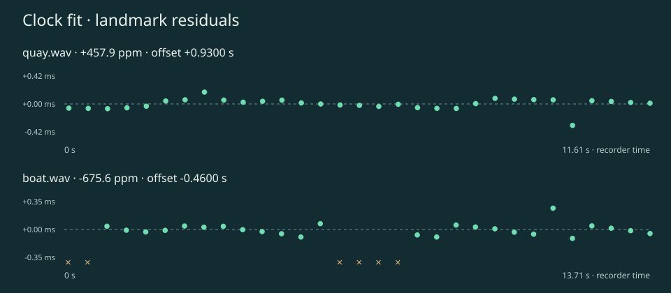

# Clockloom Audio

Synchronize WAV files from recorders that started at different moments and ran at slightly different speeds. Clockloom estimates an affine clock for each recorder, warps every channel onto the reference timeline, and saves the evidence for each timing decision. A noisy or repeated signal can cause alignment to fail explicitly.



## Reproduce a harbor recording session

Python 3.10+, NumPy and SciPy. From a checkout:

```sh
python3 -m venv .venv
. .venv/bin/activate
python -m pip install .
clockloom demo dock-session
python -m unittest discover -s tests -v
```

The command synthesizes a 14-second pier scene (wind, water noise and irregular metallic knocks), a cropped 12 kHz quay recorder, and a 22.05 kHz stereo boat recorder with a two-second dropout. All audio is generated locally. It writes source WAVs, known clock parameters, synchronized WAVs, an SVG residual chart, landmark diagnostics, and a JSON validation result. No media download is required.

| Recorder | Planted offset | Planted rate error | Offset estimation error¹ | Rate estimation error¹ |
|---|---:|---:|---:|---:|
| Quay | +930 ms | +460 ppm | +0.006 ms | −2.12 ppm |
| Boat | −460 ms | −680 ppm | −0.022 ms | +4.44 ppm |

¹Measured on the bundled deterministic scene. A positive offset means the recorder's first sample occurs later on the reference timeline. A positive ppm means each nominal recorded second spans more than one reference second. The boat fit retained 25 of 31 landmarks.

## Align a session

```sh
clockloom align dock-session/inputs/pier.wav \
  dock-session/inputs/quay.wav dock-session/inputs/boat.wav \
  --out render --anchors 31 --max-ppm 1800
```

Each output is a 32-bit floating-point WAV at the reference sample rate with exactly the reference length. Channels are preserved. Output frame coverage is half-open. Leading and trailing samples with no physical source are zero. The process preserves internal dropouts as recorded and never synthesizes missing content. Unrelated or ambiguous tracks abort the entire batch before publication. Supply a new directory for output.

## Clock recovery

1. Select the highest-variance channel, convert to a common analysis rate with an anti-aliased polyphase filter, and first-difference the waveform. Differencing attenuates stationary low-frequency components. Single-channel selection avoids inverted stereo cancellation.
2. Extract windows uniformly in recorder time. For each one compute FFT cross-correlation against every valid reference position and normalize by **local** reference variance and template energy. A nearby cluster of samples represents a single peak. The separation from the strongest distant competitor measures ambiguity. Polarity reversals can match.
3. Reject quiet and ambiguous anchors. Enumerate two-point clock hypotheses. Score by inlier count and median residual, refit the consensus with centered least squares, then check minimum temporal coverage, the fraction of agreeing candidates and drift bounds. The affine parameters satisfy `reference_seconds = offset + scale × recorder_seconds`.
4. Convert multichannel PCM from the device's nominal rate to the reference rate. Apply the residual affine correction with a 32-tap windowed sinc interpolator in bounded blocks. Emit each track with its coverage range, fit residuals and rejected landmarks. Audio amplitudes are preserved apart from interpolation; no mixing or loudness normalization is performed.

## When it works

Use shared, distinctive acoustic events recorded continuously during an overlap. Relative clock rate must be nearly constant during the session. Propagation delays are part of the fitted offset: this aligns matching sound fields and does not calibrate the geometry or the recorder hardware. Internal dropouts that remove samples shift the time axis and violate the single-clock model. Repeated music loops, isolated microphones hearing different performances, clipping, or changing reverberation can defeat waveform matching. A fit residual is an empirical diagnostic rather than a certified uncertainty interval.

All files are read into RAM. Matching 31 windows against a reference requires repeated FFT correlation. The 31-landmark demo emphasizes auditability and handles modest sessions. Long recordings would benefit from hierarchical retrieval and segment-specific clock models. The output publisher uses a private staging directory and a final same-filesystem rename; keep one writer per destination.

## Experiments and tests

- Compare offset-only alignment to affine correction on held-out audio near the end of a drifting recording. The test measures waveform correlation after the timing correction.
- Inspect the rejected orange marks in the residual SVG and match them to the dropout interval in the boat recorder.
- Repeat a one-second loop several times in both files. Distant competing peaks cause the ambiguity check to reject the recording.
- Tests cover known clock parameters in either direction, unrelated data, inverted stereo, empty overlap, whole-bundle rollback, consensus outliers and installed CLI execution.
